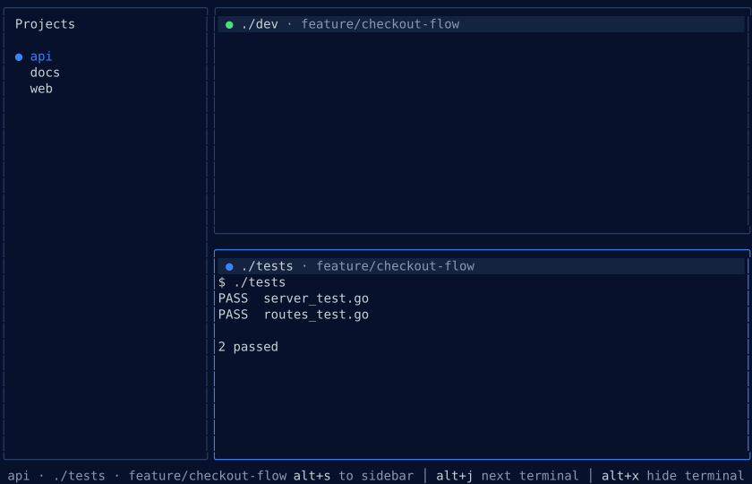
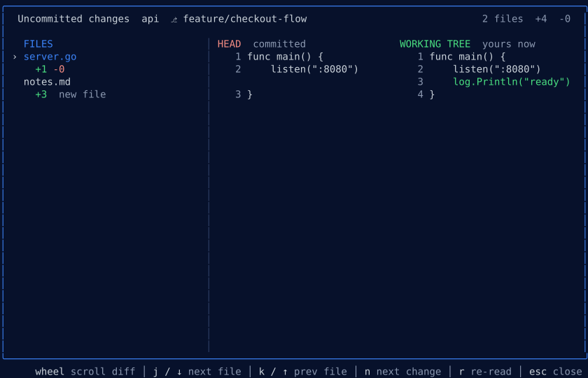

# tm

A terminal workspace manager for Linux. Run `tm` in a directory that holds
your Git repositories and get every project in a sidebar, as many terminals
per project as you need, each labelled with its branch, arranged in panes,
and remembered between sessions.



`d` on a project, or `alt+d` inside a terminal, shows what you have changed
there — committed beside current, line for line, untracked files included.



*(Both images are generated by `make screenshots`, which drives a real `tm` in
a pseudo-terminal against a throwaway workspace, so they cannot drift from
what the code actually draws.)*

- Several independent terminals per project, in split panes, with zoom.
- The branch you pick decides where a terminal opens: your checkout, the
  worktree that branch already lives in, or a new one. A branch checked out
  somewhere is reused, never duplicated.
- Any number of terminals in one directory, so a dev server and a prompt can
  share a branch.
- A terminal can remember a command, so reopening a workspace brings back your
  dev server or agent session instead of an empty shell.
- Hide a running terminal and bring it back later. A terminal that prints while
  it is off screen says so: the project's marker in the sidebar turns amber, and
  the Terminal Manager's row reads `hidden · new output`.
- Mouse wheel scrolls a terminal's history, and the diff in the changes view.
- Every terminal is drawn as its own card on one dark ground, so a four-way
  split reads as four panes rather than one wall of text.
- See what changed without leaving tm: `d` shows a project's uncommitted
  changes, each file as it was committed beside how it is now, line for line.
- Terminal definitions and layouts survive restarts. Processes do not —
  unless you turn on the background server, which keeps every terminal
  running after you close the window (opt-in, see below).
- One small JSON state file per workspace; no daemon unless you ask for one.

## Install

Needs Linux and `git` on `PATH`.

Download a binary — no Go toolchain required:

```bash
curl -sL https://github.com/Vonnue-ShijilCG/tm/releases/latest/download/tm_linux_amd64.tar.gz |
  tar -xz tm && install -m755 tm ~/.local/bin/tm && rm tm
```

Replace `amd64` with `arm64` as needed; each release also carries a
`checksums.txt`. Or build it yourself, with the Go version in `go.mod`:

```bash
go install github.com/Vonnue-ShijilCG/tm/cmd/tm@latest
```

Make sure `$(go env GOPATH)/bin` (usually `~/go/bin`) is on your `PATH`.
From a clone, `make build` puts the binary in `bin/` and `make install`
installs it.

## Usage

```bash
cd ~/workspace   # api/, web/, ... are Git repositories
tm
```

- `Enter` on a project brings back every terminal it had, in the layout you
  left them, each running its command again. A project with nothing saved gets
  one fresh shell.
- `n` adds another terminal. Give it a command to run, and a branch: the branch
  decides where the terminal opens. A branch already checked out — in your
  project or in a worktree any tool created — opens a terminal there; a branch
  checked out nowhere gets a worktree, and a new branch also asks what it starts
  from. Leave the branch empty for a shell in the project itself.
- `d` on a project, or `alt+d` inside a terminal, shows the uncommitted
  changes in that directory: the changed files on the left — new, untracked
  ones included — and the selected file shown twice in full, committed
  against current, aligned line for line. The wheel scrolls: over the columns
  it moves both of them together, over the list it picks the file. `j`/`k`
  and the arrows move the file list, `←`/`→` scroll both columns sideways,
  `n`/`N` jump between changes, `r` re-reads from git, `Esc` closes. Long
  lines are cut rather than wrapped so the two sides stay in step.
- Drag the mouse over a pane to copy from it; letting go copies. The selection
  stays inside the pane you started in, so it never picks up the card border
  or the pane beside it (your terminal's own shift+drag selection still spans
  the whole window). The text goes to your clipboard with OSC 52, so it works
  over SSH; terminals that ship with OSC 52 disabled will ignore it.
- `↻ refresh` at the bottom of the sidebar (or `r`) finds repositories added to
  the folder while tm runs; `? keys` beside it shows every shortcut.
- `alt+s` returns to the sidebar, `s` shows every shortcut, `q` quits (with the
  background server on, `q` leaves and `Q` quits; see below). Plain
  `Esc` goes to the program, so it interrupts Claude Code and leaves Vim's
  insert mode as usual.
- Inside a terminal everything you type reaches the program. Only a few
  `Alt` chords belong to `tm`; press `s` in the sidebar to see them.

### Keep terminals running after you close the window

Add this to `~/.config/tm/config.toml`:

```toml
server = true
```

`tm` then runs your terminals in a small background server, one per
workspace folder, and the window only shows them. Close the window, lose
the SSH connection, run `tm` again in the same folder, and every terminal is
where you left it — hidden ones included — still running, with what it
printed meanwhile. A project whose terminals printed while you were away has
its sidebar marker turned amber.

| Key / command | With `server = true` |
| --- | --- |
| `q` / `ctrl+c` (sidebar), or closing the window | Leave. Every terminal keeps running. |
| `Q` (sidebar) | Stop everything: kill every terminal, save the layout, end the server. What `q` does without the server. |
| `alt+delete`, or `d` in the Terminal Manager | Kill that one terminal, as always. |
| `tm stop` (in the workspace folder) | Stop the server and every terminal in it, from outside `tm`. |

Running `tm` while another window already has the workspace open moves it to
the new window; the old one exits saying `tm: opened in another window`. A
terminal that finishes while no window is open is gone the next time, just
as it would be had the window stayed open.

No process survives a reboot: after one, `tm` brings back the layout and
re-runs each terminal's command from `.terminal-state.json`, exactly as
without the server. With `server` off, `tm` refuses to start while a server
still holds this workspace's terminals, rather than run every command
twice; turn the setting back on to reattach, or run `tm stop`.

## Where things live

| What | Where |
| --- | --- |
| Saved terminals and layouts | `<workspace>/.terminal-state.json` |
| Worktrees created by `tm` | `<workspace>/.terminal-worktrees/<project>/` |
| Configuration | `~/.config/tm/config.toml` (`max_terminals = 6`, `server = true`) |
| Background server socket, lock and log | `~/.local/state/tm/` (`$XDG_STATE_HOME/tm`) |

`tm` only removes worktrees it created and that no terminal still uses. The
project's own checkout is never touched.

The state file records the command each terminal runs, and `tm` runs it when
that terminal starts. Treat it like a `Makefile` or a `.envrc`: only run `tm`
in a workspace whose `.terminal-state.json` you trust, since opening a project
there runs the commands it contains.

## Development

`make check` runs what CI runs: `gofmt`, `go vet`, `go test`, `go test
-race`, `go build`.

Limitations: Linux only. Inside a terminal `tm` reserves its `Alt` chords,
so programs that bind those keys (Emacs `M-x`, readline `M-n`) lose them.
While `tm` runs it owns the mouse, so selecting text in the host terminal
needs `Shift` held.

## License

MIT. See [LICENSE](LICENSE).
